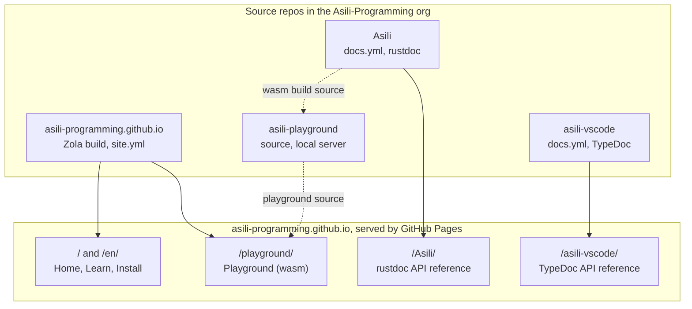

# Asili website — Technical Requirements Document

As of 7 November 2026 · Victor Kaiuki

The site is built with Zola from the `asili-programming.github.io` repo and deployed by GitHub
Actions to GitHub Pages. The site's workflow also builds the playground from the `asili-playground`
repo into `/playground/`; rustdoc and TypeDoc publish from their own repos as project pages under the
same domain. This document implements the requirements in the
[Product Requirements Document](01-product-requirements.md) (FR-n, NFR-n).

## Architecture

The site serves home and playground; two repos add their API docs.

The site repo's `site.yml` deploys `/`, `/en/` and `/playground/`: Zola builds Home, Learn and
Install, and the same workflow builds the playground from `asili-playground` with wasm compiled from
Asili. `Asili` and `asili-vscode` deploy their own API docs to the paths named after them.

## Stack decision

Use Zola: a single Rust binary with built-in multilingual pages, Markdown content and templates, and
no Node toolchain. That matches NFR-8 (edit text without JavaScript tooling) and a Rust project's
contributors. Confirmed on 7 November 2026.

| Option | Multilingual | Toolchain to edit text | Verdict |
| --- | --- | --- | --- |
| Zola | Built in: `default_language` plus `[languages.en]`, `page.en.md` beside `page.md` | One binary | **Chosen** |
| Hand-written HTML (today) | 10 files with the nav copied into each (5 pages × 2 languages) | None | Rejected: duplicated nav and footer drift, against the org's write-once rule |
| Hugo | Built in | One binary | Viable; rejected only because Zola keeps the stack in Rust |
| Astro or another Node framework | Plugins | Node, npm, a lockfile to maintain | Rejected: fails NFR-8 |

Pages are Markdown in `content/`; layout is Tera templates in `templates/`; one `static/` folder
holds CSS, fonts and images. No client-side framework: the only JavaScript on the main site is the
language switch (under 1 KB).

## URLs and hosting

Swahili pages sit at the root and English under `/en/`, as decided on 7 November 2026. Paths named
after a repo are served by that repo's own Pages deployment, so the site repo must never create a
folder with those names.

| Path | Content | Served by | Status today |
| --- | --- | --- | --- |
| `/` and `/en/` | Home | `asili-programming.github.io` (Zola build) | Single English page live |
| `/jifunze/` and `/en/learn/` | Learn: six-concept tour | `asili-programming.github.io` | To build |
| `/sakinisha/` and `/en/install/` | Install Pata | `asili-programming.github.io` | To build |
| `/playground/` | Playground; language from `?lugha=sw` or `?lugha=en` | `asili-programming.github.io`; `site.yml` builds it from the `asili-playground` repo | To build |
| `/404.html` | Not found, both languages on one page | `asili-programming.github.io` | To build |
| `/Asili/` | Rustdoc (capital A: repo name) | `Asili` repo, `docs.yml` | Enabled, returns 404 until the workflow runs |
| `/asili-vscode/` | TypeDoc for the extension | `asili-vscode` repo, `docs.yml` | Live |

Deployment: the site repo switches from branch publishing (`main`, `/`) to the `GitHub Actions`
source, so the Zola build output is deployed without being committed. Until then, `_config.yml`
keeps this `docs/` folder out of the branch-published site.

## Playground integration

The playground is part of the site: `site.yml` builds it from the `asili-playground` repo and places
it at `/playground/`. The `asili-playground` repo stays the source, and its Asili static server
(`pata jenga --tenda`) keeps serving the same files for anyone who runs it locally or self-hosts.

Build steps in `site.yml`:

1. Check out the site repo, `asili-playground` and `Asili` (`ref: main`, so the hosted playground
   matches released Asili).
2. Build the wasm package with the playground's `build.sh` (`wasm-pack`, feature `wasm-browser`),
   with `ASILI_DIR` pointing at the Asili checkout; cache the cargo build.
3. After `zola build`, copy `index.html`, `main.js`, `style.css`, `samples/` and `pkg/` into the
   output as `public/playground/`.
4. Rebuild on push to the site's `main`, weekly, and when `asili-playground`'s `main` changes (a
   `repository_dispatch` sent from its CI).

Required changes in the playground:

- **Relative paths only.** Every asset path stays relative (`./pkg/...`, `samples/manifest.json`),
  so the same files work at `/playground/`, at a self-hosted root, and on `127.0.0.1:8080`.
- **Vendor CodeMirror.** `main.js` imports five CodeMirror 6 packages from `esm.sh` at load time.
  That breaks NFR-6 (no third parties) and depends on a CDN. Commit pinned, pre-bundled ES modules
  under `vendor/`, regenerated by a script, not at build time.
- **Language parameter.** Read `?lugha=sw|en` so the site's language switch carries over; UI strings
  move into one table per language.
- **Size budget.** Record the gzipped size of `asili_wasm_bg.wasm` in the workflow summary and fail
  above a set budget (NFR-2), once the first build gives a baseline.
- **Host hook.** Keep `globalThis.asili_nguvu_load` defined before the module initialises: native
  code from `nguvu` is instantiated through it (`driver/wasm/README.md` in Asili).
- **Self-hosting documented.** The playground README gives both routes: the hosted URL, and
  `build.sh` followed by `pata jenga --tenda`.

## Languages

Every page is written twice, `page.md` (Swahili) and `page.en.md` (English), and Zola builds both; a
build check fails when either file is missing (FR-6).

- **Config.** `default_language = "sw"`, `[languages.en]`; interface strings (nav, footer, buttons)
  live in `[translations]` tables, one per language, never in templates.
- **Markup.** `<html lang="sw">` or `lang="en"` per page (NFR-3); each page carries
  `<link rel="alternate" hreflang>` to its twin, and the sitemap lists both.
- **Switch.** A link in the header to the same page in the other language. Clicking it stores the
  choice in `localStorage` (`asili-lugha`); a page reads it only to highlight the current language,
  never to redirect, so links always open the language they name.
- **First visit at `/`.** No redirect: static hosting cannot read `Accept-Language`, and a script
  redirect would cost a round trip on 3G. The home page shows a one-line "Read in English" link
  instead.
- **Swahili copy.** Written with the project's existing vocabulary and register
  (`swahili-docs-and-errors` conventions, NFR-4); English is translated from it, not the other way
  round.

## CI and quality gates

One workflow, `site.yml`, runs the checks on every pull request and deploys on push to `main` only
when they all pass.

| Check | Tool | Fails when | Covers |
| --- | --- | --- | --- |
| Build | `zola build` | Template or content error | All |
| Internal links and anchors | `zola check` | A link inside the site is broken | FR-2, FR-7 |
| External links | `lychee` on the built HTML (weekly schedule too) | A link out returns 4xx or 5xx | FR-7 |
| Translation pairs | Script: every `*.md` has its `*.en.md` | A page exists in one language only | FR-6 |
| Code samples | Script: extract each `asili` code block, build it with `pata jenga --tenda` from Asili `main` (cached) | A sample does not compile or run | NFR-9 |
| Performance and accessibility | Lighthouse CI against the built site, mobile profile | Performance below 90 or Accessibility below 95 | NFR-1, NFR-3 |
| Page weight | Script: sum of transferred bytes for `/` | Home page above 100 KB | NFR-1 |

Deploy: `actions/upload-pages-artifact` then `actions/deploy-pages`, as the `Asili` repo's
`docs.yml` already does. Branches follow the org's Git-Flow use: work on `develop`, release to
`main`.

## Constraints and risks

GitHub Pages is static hosting with soft usage limits (approximately 1 GB per published site and
100 GB of bandwidth a month, from GitHub's published limits; not checked for this document). Nothing
planned comes close; the wasm download is the largest item.

| Risk | Effect | Mitigation |
| --- | --- | --- |
| Wasm module too large for 3G | Playground misses NFR-2; learners give up | Size budget in CI; load only on the playground page; show a progress state while it downloads |
| Pata has no binary releases | Install page can only offer build from source, which needs Rust | Install page is honest about it; add release binaries to the Asili release process (separate issue) |
| `/Asili/` rustdoc still 404 | Dead link from the home page today | Run `docs.yml` once by `workflow_dispatch`; until it works, hide the link |
| A repo-named folder in the site repo | Shadowed by, or shadowing, that repo's project page; `/playground/` belongs to the site and needs no repo of that name | CI check that `content/` and `static/` have no top-level `Asili`, `asili-vscode` or `asili-playground` |
| Samples break as the language changes | Site shows code that does not compile | Samples built against Asili `main` in CI, weekly as well as on pull requests |
| Swahili copy reads as machine translation | Loses the primary audience's trust | Swahili written first, by the project's conventions; native-speaker review before launch |
| CDN dependency in the playground | Breaks when esm.sh is down; leaks visitors' IPs to a third party | Vendor CodeMirror (Playground integration) |
