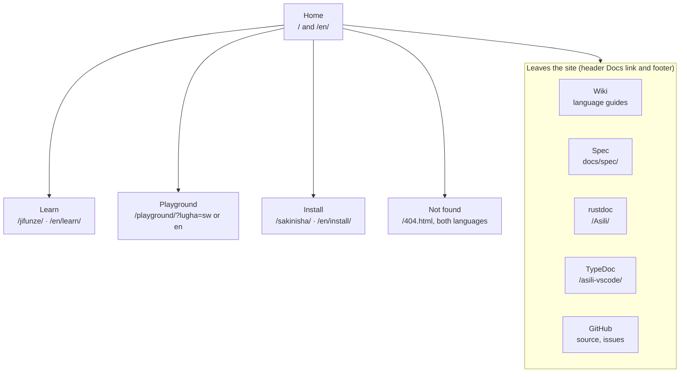
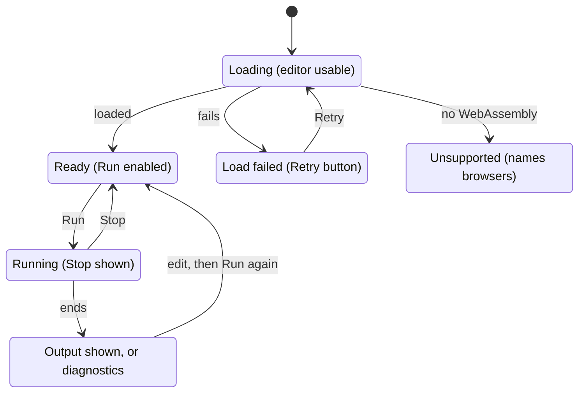

# Asili website — App Flow

As of 7 November 2026 · Victor Kaiuki

Every visitor lands on Home and is two clicks from running code, installing Pata, or reading the
docs. The playground lives on the site at `/playground/`; the same files run locally with Asili's own
static server for anyone who wants to self-host.

## Site map

Four site pages hang off Home; docs and code stay on GitHub.

Each site page exists in both languages; the playground is the page the home page pushes hardest.
Learn links into the playground for every sample, and the playground's output panel links to Learn
and Install.

## Navigation rules

The header is identical on every page, the playground included, so a visitor is never stranded
(FR-2).

| Header item | Swahili label (to review) | English label | Goes to |
| --- | --- | --- | --- |
| Logo | Asili | Asili | Home in the current language |
| Learn | Jifunze | Learn | `/jifunze/`, `/en/learn/` |
| Playground | Uwanja | Playground | `/playground/?lugha=sw` or `?lugha=en` |
| Install | Sakinisha | Install | `/sakinisha/`, `/en/install/` |
| Docs | Nyaraka | Docs | The wiki (opens on GitHub) |
| Language switch | English | Kiswahili | The same page in the other language |
| GitHub icon | — | — | `github.com/Asili-Programming` |

- Links that leave the site (wiki, GitHub, API references) show an outward arrow and open in the
  same tab.
- The current page is marked in the header (`aria-current="page"`).
- The footer carries the secondary links: Spec, API reference (rustdoc and TypeDoc), Contributing,
  Code of conduct, Security, License.
- Below 640 px wide the header items fold into a menu button; the language switch and the
  Playground link stay visible.

## Journey 1: a learner runs a first program

Goal: from a shared link to edited, running code in under a minute, with no install (PRD outcome 2).

1. Opens `asili-programming.github.io` from a link a teacher or friend shared; Home loads in Swahili.
2. Reads the one-line description and the sample program in the hero.
3. Presses **Iendeshe** (Run it) under the sample: goes to `/playground/?lugha=sw` with the Karibu
   sample loaded.
4. Waits while the playground loads (progress shown); the editor is usable before the wasm finishes.
5. Presses Run: output appears in the panel below the editor.
6. Changes a line, for example the name in a `chapisha` call, and runs again.
7. Makes a mistake: the diagnostic appears in Swahili with its line number, and the line is marked
   in the editor.
8. Opens the sample picker and tries Sifa (traits and structs) or Makosa (error handling).
9. Next step offered under the output: **Jifunze zaidi** (Learn more) to the tour, or
   **Sakinisha Pata** to install.

## Journey 2: a developer evaluates and installs

Goal: decide whether Asili is worth trying, then have `pata` running locally (PRD outcomes 1 and 3).

1. Arrives from GitHub or a post, often at `/en/`; switches language if needed.
2. Scans Home: what Asili is, the sample, three short claims (Swahili keywords, native code only,
   C-speed benchmark), each with a link.
3. Opens **Learn**: six concepts on one page (functions and `weka`, types, `Chaguo` and `Tokeo`,
   structs and traits, modules with `leta`, concurrency with `sawia`), each with a code sample and a
   link to its wiki page.
4. Tries a sample from Learn in the playground (same flow as Journey 1, steps 4 to 6).
5. Opens **Install**: the page detects the operating system from the user agent and shows that tab
   first (Linux, macOS, Windows); all three stay one click away.
6. Follows the steps: install Rust with rustup, clone Asili, `cargo build --release`, put `pata` on
   the `PATH`, run `pata njozi` to create a project and `pata jenga --tenda` to run it.
7. Each step shows its expected output, so the visitor can tell it worked.
8. Next step offered at the end: the VS Code extension, then the CLI reference on the wiki.

## Journey 3: a contributor finds where to start

Goal: reach the right repo, guide and reference without hunting through the org.

1. Arrives at Home, already knowing what Asili is.
2. Scrolls to the **Changia** (Contribute) band near the footer: one line on the project's values,
   then four links.
3. Picks a path:
    - Language or toolchain: `CONTRIBUTING.md` in the Asili repo, then the rustdoc API reference at
      `/Asili/`.
    - Editor support: the `asili-vscode` repo and its TypeDoc at `/asili-vscode/`.
    - Playground: the `asili-playground` repo, whose README covers running it locally with
      `pata jenga --tenda`.
    - The site itself: this repo, `asili-programming.github.io`.
4. Opens issues labelled `good first issue` across the org (one GitHub search link).
5. Reads the code of conduct before the first pull request.

## Playground states

Every path except an unsupported browser returns to Ready.

The editor accepts typing from the first moment, before the wasm module has loaded. Stop ends a run
and keeps the output so far, which means the program runs off the main thread (in a Web Worker the
page can terminate).

## Edge cases

Every page except the playground works with JavaScript off; the playground says plainly what it needs
when it cannot run.

| Situation | What the visitor sees | Where |
| --- | --- | --- |
| JavaScript disabled | All content pages work; the language switch is a plain link. Playground shows a message that it needs JavaScript, with a link to the install page | All pages |
| Browser without WebAssembly | Playground shows that the browser cannot run Asili code and names the supported browsers (NFR-7) | Playground |
| Wasm download fails or times out | Error state with a Retry button; the editor and its text stay | Playground |
| Program runs forever | A Stop button ends the run; the output so far stays | Playground |
| Visitor goes offline after load | Running still works: the program runs in the browser | Playground |
| Unknown path | 404 page in both languages, with links to Home, Learn and Playground | Site |
| Old link to the single-page site's sections | Home loads; no anchors are promised | Site |
| `?lugha=` missing or unknown | Playground falls back to the stored choice, then to Swahili | Playground |
