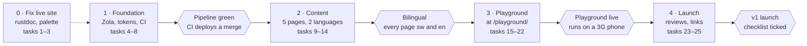

# Asili website — Implementation Plan

As of 7 November 2026 · Victor Kaiuki

Five phases take the site from today's single page to a bilingual Zola site with the playground at
`/playground/`. Phase 0 can start today and needs no decisions; no dates are set yet, so phases are
ordered, not scheduled.

## Roadmap

Four gates stand between the live page and the v1 launch.

Phase 0 fixes what is live today and runs alongside Phase 1. Playground tasks 15 to 18 live in the
playground repo and can start as soon as Phase 1 begins; only task 19 needs the Zola pipeline. v2
items (shareable playground links, docs on the site, release notes, benchmark page) follow launch.

## Task tracker

Twenty-five tasks across three repos; one is done. Requirement IDs point to the
[Product Requirements Document](01-product-requirements.md) (FR, NFR); App Flow and Design Brief
tasks name their document.

| # | Task | Repo | Covers | Phase | Status |
| --- | --- | --- | --- | --- | --- |
| 1 | Publish the static landing page | site | FR-1 | 0 Fix live site | Done |
| 2 | Run `docs.yml` by `workflow_dispatch` so `/Asili/` resolves; hide the link until it does | Asili | FR-7 | 0 Fix live site | Not started |
| 3 | Swap the landing page to the brand palette (olive, copper, paper) | site | Design Brief | 0 Fix live site | Not started |
| 4 | Zola scaffold: `sw` default, `[languages.en]`, base template, header and footer partials, `[translations]` | site | FR-2, FR-6 | 1 Foundation | Not started |
| 5 | `static/tokens.css` from the Design Brief, light and dark | site | NFR-3 | 1 Foundation | Not started |
| 6 | `site.yml`: build, `zola check`, deploy; switch the Pages source to GitHub Actions | site | NFR-5 | 1 Foundation | Not started |
| 7 | CI checks: lychee, translation pairs, reserved folder names, home page weight | site | FR-6, FR-7, NFR-1 | 1 Foundation | Not started |
| 8 | Lighthouse CI with the performance and accessibility budgets | site | NFR-1, NFR-3 | 1 Foundation | Not started |
| 9 | Home page in Swahili and English, with the hero sample | site | FR-1 | 2 Content | Not started |
| 10 | Learn page: six concepts, each with a sample and a wiki link | site | FR-8 | 2 Content | Not started |
| 11 | Install page: Linux, macOS and Windows tabs, build from source | site | FR-5 | 2 Content | Not started |
| 12 | 404 page in both languages | site | FR-9 | 2 Content | Not started |
| 13 | Sample check: build every `asili` code block with `pata` from Asili `main` | site | NFR-9 | 2 Content | Not started |
| 14 | Vector logo, favicon set, social preview images | site | Design Brief | 2 Content | Not started |
| 15 | Vendor CodeMirror under `vendor/`; drop the `esm.sh` imports | asili-playground | NFR-6 | 3 Playground | Not started |
| 16 | Relative asset paths; `?lugha=` parameter and per-language string tables | asili-playground | FR-6 | 3 Playground | Not started |
| 17 | Run programs in a Web Worker, with a Stop button | asili-playground | App Flow | 3 Playground | Not started |
| 18 | Loading, load-failed and unsupported states | asili-playground | App Flow | 3 Playground | Not started |
| 19 | `site.yml` builds the wasm from Asili and copies the playground to `public/playground/` | site | FR-3, FR-4 | 3 Playground | Not started |
| 20 | `repository_dispatch` from the playground's CI to rebuild the site | asili-playground | FR-3 | 3 Playground | Not started |
| 21 | Wasm size budget in CI, set from the first build | site | NFR-2 | 3 Playground | Not started |
| 22 | Playground README: hosted URL, and self-hosting with `pata jenga --tenda` | asili-playground | FR-3 | 3 Playground | Not started |
| 23 | Native-speaker review of every Swahili page and string | site | FR-6, NFR-4 | 4 Launch | Not started |
| 24 | Keyboard, contrast and 3G phone pass | site | NFR-1, NFR-2, NFR-3 | 4 Launch | Not started |
| 25 | Point the Asili README, wiki Home and CONTRIBUTING at the site | Asili, wiki | PRD outcome 3 | 4 Launch | Not started |

## Decisions needed first

Confirmed on 7 November 2026: Swahili at the root, Swahili-speaking learners first, Zola, and no
analytics at launch, so Phase 1 is unblocked. The heading font, custom domain and Pata releases are
still open. Settled earlier: the playground lives at `/playground/` on the site, built from
`asili-playground`, and stays self-hostable with Asili's own static server.

| Decision | Blocks | Status |
| --- | --- | --- |
| Default language at `/` | Phase 1 (task 4) | Decided: Swahili at `/`, English at `/en/` |
| Primary audience | Phase 2 copy (tasks 9 to 11) | Decided: Swahili-speaking learners |
| Zola as the generator | Phase 1 (task 4) | Decided: Zola |
| Analytics | Phase 4 metrics | Decided: none at launch; revisit after 90 days |
| Heading font (Outfit, Lexend or other) | Phase 1 (task 5) | Open: designer's pick within 30 KB |
| Custom domain | Nothing in v1 | Open: recommend staying on asili-programming.github.io |
| Pata binary releases | Install page wording (task 11) | Open: separate issue in the Asili repo; the page says build from source until then |

Once decided, file each phase's tasks as issues and add them to project 17 ("Asili Feature
release").

## Launch checklist

v1 is done when every box below is ticked on the deployed site, not on a local build.

- [ ] Home, Learn, Install and 404 exist in Swahili and English, and the switch moves between twins
  (FR-1, FR-2, FR-6, FR-8, FR-9).
- [ ] `/playground/` runs all three samples on a mid-range Android phone over throttled 3G,
  interactive within 5 s (FR-3, FR-4, NFR-2).
- [ ] The same playground files run locally with `build.sh` and `pata jenga --tenda`.
- [ ] `/Asili/` and `/asili-vscode/` both load (FR-7).
- [ ] CI on `main` is green: links, translation pairs, samples, Lighthouse at least 90 and 95, home
  page under 100 KB.
- [ ] No request leaves the domain on any page (NFR-6).
- [ ] Native-speaker and keyboard reviews signed off.
- [ ] Asili README, wiki Home and CONTRIBUTING link to the site.
